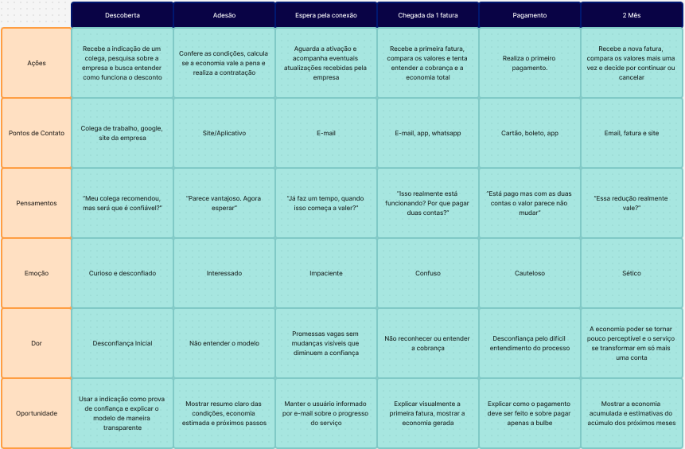
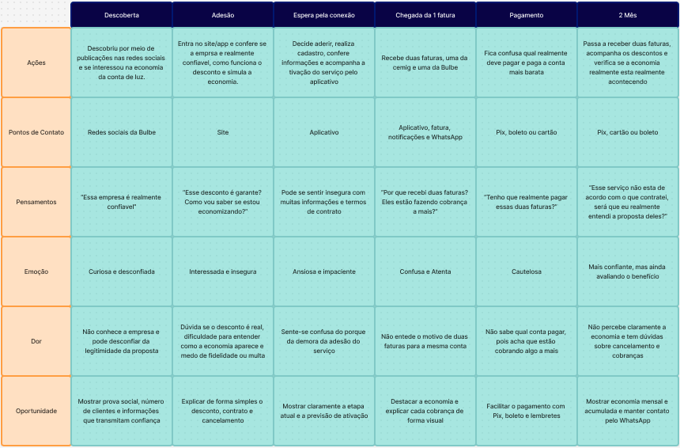

# Mapa de jornada do usuário
## Persona 

- **Nome e idade:** [Sérgio, 45 anos]
- **Contexto:** [Conheceu a empresa pela indicação de um colega de trabalho]
- **Objetivo:** [Procura reduzir as despesas para direcionar o dinheiro a projetos pessoais]
- **Medos e dúvidas:** ["O que a empresa ganha com isso?" "O desconto vale mesmo a pena?" "Tenho que pagar duas contas?"]
- **Canais que usa:** [Usa whatsapp apenas para mensagens importantes ou conversas com pessoas próximas e só visualiza questões de serviços e profissionais por email]

## Mapa

## Persona

- **Nome e idade**: [Maria, 39 anos]
- **Contexto**: [Conheceu a Bulbe por meio de uma publicação nas redes sociais]
- **Objetivo**: [Quer diminuir os gastos fixos da casa para conseguir guardar mais dinheiro todos os meses]
- **Medos e dúvidas**: ["Essa empresa existe mesmo? Esse desconto é garantido?" "Como sei se realmente estou economizando?""Tem fidelidade ou multa para cancelar?"]
- **Canais que usa**: [Usa WhatsApp para tudo, não entra no e-mail]

## Mapa

